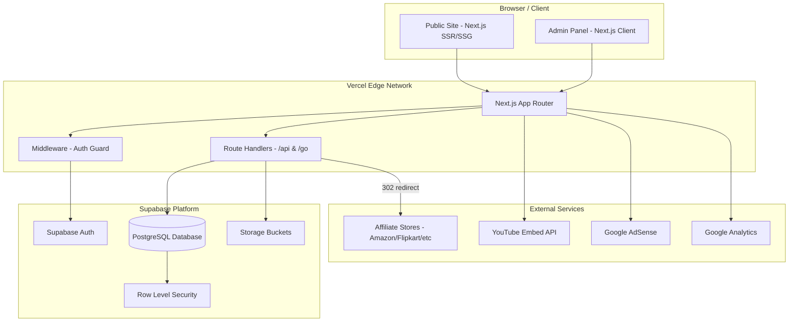
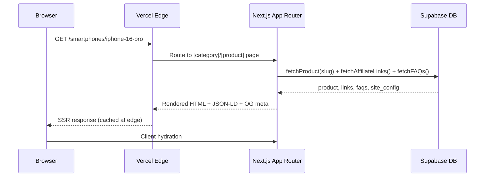
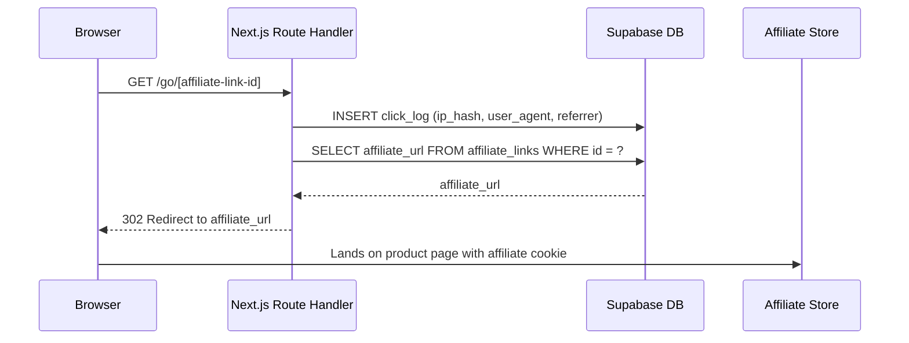
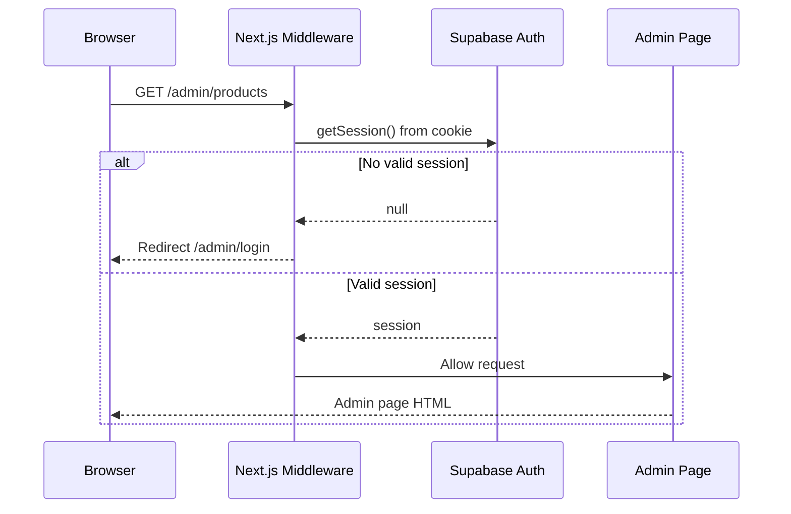

# Design Document: White-Label Tech Creator Affiliate & Product Comparison Platform

## Overview

A full-stack, production-ready tech product review and affiliate platform built for Indian tech YouTubers. The platform enables a creator's audience to browse curated products, compare specs, read FAQs, watch embedded reviews, and purchase through affiliate links across major Indian retailers (Amazon.in, Flipkart, Croma, Vijay Sales, Reliance Digital). All content is managed through a protected admin panel, and the entire branding layer is swappable via a `site_config` table — making this a true white-label skeleton that can be redeployed for any creator without code changes.

The system is built on Next.js 14+ (App Router) with TypeScript, Tailwind CSS, Supabase (PostgreSQL + Auth + Storage), and deployed on Vercel. It targets a 90+ Lighthouse score with full SEO coverage including JSON-LD schemas, dynamic sitemaps, and Open Graph metadata.

## Architecture

### High-Level System Architecture



### Request Flow — Public Page



### Request Flow — Affiliate Click Tracking



### Request Flow — Admin Auth Guard



## Components and Interfaces

### Component 1: SiteConfig Provider

**Purpose**: Loads the single `site_config` row at the root layout level and injects branding tokens (colors, logo, name) into the entire app via React context and CSS custom properties.

**Interface**:
```typescript
interface SiteConfig {
  id: string
  site_name: string
  tagline: string
  logo_url: string
  favicon_url: string
  primary_color: string       // hex, e.g. "#FF6B00"
  secondary_color: string
  creator_name: string
  creator_photo_url: string
  creator_youtube_channel_url: string
  social_links: Record<string, string>  // { twitter: url, instagram: url, ... }
  footer_text: string
  google_adsense_id: string | null
  google_analytics_id: string | null
  meta_default_title: string
  meta_default_description: string
}

interface SiteConfigContextValue {
  config: SiteConfig
}

function SiteConfigProvider({ children, config }: {
  children: React.ReactNode
  config: SiteConfig
}): JSX.Element
```

**Responsibilities**:
- Fetched once in root `layout.tsx` via server component
- Injects `--color-primary` and `--color-secondary` as CSS vars on `<html>`
- Provides config to all client components via context

---

### Component 2: Product Card

**Purpose**: Reusable card displayed in category grids, homepages, and best-of lists.

**Interface**:
```typescript
interface ProductCardProps {
  product: ProductSummary
  showDealBadge?: boolean
  rank?: number              // for best-of lists
  pickReason?: string        // for best-of lists
}

interface ProductSummary {
  id: string
  name: string
  slug: string
  category_slug: string
  brand_name: string
  thumbnail_url: string
  creator_rating: number     // 0–10
  current_price_inr: number
  launch_price_inr: number
  is_deal_of_the_day: boolean
  deal_badge_text: string | null
  tags: string[]
}
```

**Responsibilities**:
- Renders thumbnail, name, brand, rating badge, price in ₹ lakh format
- Shows deal badge when `is_deal_of_the_day` or `deal_badge_text` present
- Links to `/[category_slug]/[slug]`
- Includes "Compare" toggle button

---

### Component 3: Comparison Engine

**Purpose**: Manages the client-side state of which products are being compared and renders the spec-diff table.

**Interface**:
```typescript
interface CompareState {
  productIds: string[]       // max 4
  products: ProductDetail[]
}

interface CompareActions {
  addProduct(id: string): void
  removeProduct(id: string): void
  clearAll(): void
}

interface SpecDiffRow {
  specKey: string
  label: string
  values: (string | number | null)[]
  hasDiff: boolean           // true if values differ across products
}

function buildSpecDiffTable(products: ProductDetail[]): SpecDiffRow[]
```

**Responsibilities**:
- Persists compare list in `localStorage` + URL params
- Highlights rows where spec values differ
- Renders quick verdict box (best value, best performance picks)

---

### Component 4: Affiliate Buy Section

**Purpose**: Sticky sidebar/bottom bar on product detail page showing all affiliate links sorted by price.

**Interface**:
```typescript
interface AffiliateLink {
  id: string
  product_id: string
  store_name: string         // "Amazon", "Flipkart", "Croma", etc.
  store_icon: string         // URL
  affiliate_url: string      // internal: /go/[id]
  price_inr: number
  is_best_price: boolean
  last_updated: string       // ISO date
}

interface BuySectionProps {
  links: AffiliateLink[]
  productName: string
}
```

**Responsibilities**:
- Sorts links by `price_inr` ascending
- Marks best price with badge
- All links route through `/go/[id]` for click tracking
- Shows "last updated" timestamp per link

---

### Component 5: Admin Product Form

**Purpose**: Dynamic CRUD form for products where spec fields are generated from the selected category's `spec_template`.

**Interface**:
```typescript
interface SpecTemplate {
  fields: SpecField[]
}

interface SpecField {
  key: string
  label: string
  type: "text" | "number" | "select" | "boolean" | "multiselect"
  unit?: string              // "GHz", "mAh", "inches", etc.
  options?: string[]         // for select/multiselect
  required?: boolean
}

interface ProductFormProps {
  product?: ProductDetail    // undefined = create mode
  categories: Category[]
  brands: Brand[]
  onSave(data: ProductFormData): Promise<void>
}
```

**Responsibilities**:
- On category change, fetches `spec_template` and re-renders spec fields
- Handles image upload to Supabase Storage
- Validates required spec fields before submit
- Supports bulk CSV import via file input

---

### Component 6: Search

**Purpose**: Full-text search with auto-suggest powered by Supabase `pg_trgm` or `to_tsvector`.

**Interface**:
```typescript
interface SearchResult {
  id: string
  name: string
  slug: string
  category_slug: string
  thumbnail_url: string
  current_price_inr: number
  type: "product" | "category" | "brand"
}

async function searchProducts(query: string, limit?: number): Promise<SearchResult[]>
```

**Responsibilities**:
- Debounced auto-suggest (300ms) on keystroke
- Full results page at `/search?q=...`
- Searches product name, tags, brand name, category name

## Data Models

### Model: Product (full detail)

```typescript
interface ProductDetail {
  id: string
  name: string
  slug: string
  category_id: string
  category_slug: string
  brand_id: string
  brand_name: string
  tagline: string
  description: string
  specifications: Record<string, string | number | boolean>
  pros: string[]
  cons: string[]
  creator_rating: number          // 0.0–10.0
  youtube_video_url: string | null
  youtube_short_url: string | null
  thumbnail_url: string
  gallery_images: string[]
  launch_price_inr: number
  current_price_inr: number
  is_featured: boolean
  is_deal_of_the_day: boolean
  deal_badge_text: string | null
  is_published: boolean
  tags: string[]
  created_at: string
  updated_at: string
  affiliate_links: AffiliateLink[]
  faqs: FAQ[]
}
```

**Validation Rules**:
- `slug` must be unique, URL-safe, auto-generated from `name` if not provided
- `creator_rating` must be between 0 and 10 inclusive
- `specifications` keys must match the parent category's `spec_template.fields[].key`
- At least one `affiliate_link` required before `is_published` can be true
- `thumbnail_url` required before publish

---

### Model: Category

```typescript
interface Category {
  id: string
  name: string
  slug: string
  icon: string               // emoji or icon name
  description: string
  spec_template: SpecTemplate
  display_order: number
  created_at: string
}
```

**Spec Templates by Category** (defined in `spec_template.fields`):

| Category | Key Spec Fields |
|---|---|
| Smartphones | display_size, display_type, processor, ram, storage, battery, camera_main, camera_front, os, 5g |
| Laptops | display_size, processor, ram, storage_type, storage_size, gpu, battery_wh, weight, os, ports |
| Earbuds | driver_size, anc, battery_buds, battery_case, codec, water_resistance, connectivity |
| Smartwatches | display_size, display_type, battery_days, gps, health_sensors, water_resistance, os |
| Tablets | display_size, processor, ram, storage, battery, stylus_support, cellular |
| Power Banks | capacity_mah, max_output_w, ports, fast_charge, weight |
| Cameras | sensor_size, megapixels, video_max, stabilization, mount_type, weather_sealed |
| Smart TVs | display_size, panel_type, resolution, refresh_rate, os, hdmi_ports, dolby_vision |
| Gaming Consoles | storage, resolution_max, fps_max, online_service, backward_compat, disc_drive |

---

### Model: Deal

```typescript
interface Deal {
  id: string
  product_id: string
  deal_type: "price_drop" | "bank_offer" | "sale_event" | "coupon"
  headline: string
  original_price_inr: number
  deal_price_inr: number
  store_name: string
  affiliate_url: string
  starts_at: string          // ISO datetime
  expires_at: string | null
  is_active: boolean
  created_at: string
}
```

**Validation Rules**:
- `deal_price_inr` must be less than `original_price_inr`
- `expires_at` null means deal has no expiry
- `is_active` auto-set to false when `expires_at` is in the past (cron or DB trigger)

---

### Model: ClickLog

```typescript
interface ClickLog {
  id: string
  affiliate_link_id: string
  product_id: string
  store_name: string
  clicked_at: string
  user_agent: string
  referrer: string | null
  ip_hash: string            // SHA-256 of IP — no raw IP stored (GDPR-safe)
}
```

---

### Model: BestOfList

```typescript
interface BestOfList {
  id: string
  title: string
  slug: string
  description: string
  cover_image_url: string
  is_published: boolean
  display_order: number
  created_at: string
  updated_at: string
  items: BestOfListItem[]
}

interface BestOfListItem {
  id: string
  list_id: string
  product_id: string
  product: ProductSummary
  rank: number
  pick_reason: string
}
```

## Key Functions with Formal Specifications

### Function: fetchProductDetail()

```typescript
async function fetchProductDetail(
  categorySlug: string,
  productSlug: string
): Promise<ProductDetail | null>
```

**Preconditions**:
- `categorySlug` and `productSlug` are non-empty URL-safe strings
- Supabase client is initialized with valid credentials

**Postconditions**:
- Returns `ProductDetail` with nested `affiliate_links` and `faqs` if product exists and `is_published = true`
- Returns `null` if product not found or not published (triggers Next.js `notFound()`)
- Result includes joined `brand_name` and `category_slug`
- `affiliate_links` sorted by `price_inr` ascending

**Loop Invariants**: N/A (single query with joins)

---

### Function: handleAffiliateRedirect()

```typescript
async function handleAffiliateRedirect(
  affiliateLinkId: string,
  request: Request
): Promise<Response>
```

**Preconditions**:
- `affiliateLinkId` is a valid UUID string
- `request` contains headers (user-agent, referer)

**Postconditions**:
- A `click_log` row is inserted with hashed IP, user_agent, referrer, timestamp
- Returns HTTP 302 response with `Location` header set to `affiliate_url`
- If `affiliateLinkId` not found: returns HTTP 404
- IP is stored as SHA-256 hash only — raw IP never persisted

**Loop Invariants**: N/A

---

### Function: buildSpecDiffTable()

```typescript
function buildSpecDiffTable(products: ProductDetail[]): SpecDiffRow[]
```

**Preconditions**:
- `products` array has 2–4 elements
- All products belong to the same category (same spec keys)

**Postconditions**:
- Returns one `SpecDiffRow` per spec key in the category's `spec_template`
- `hasDiff = true` if and only if at least two products have different values for that key
- Rows with all-null values across all products are excluded
- Order of rows matches `spec_template.fields` order

**Loop Invariants**:
- For each spec key iteration: all previously processed rows are valid `SpecDiffRow` objects

---

### Function: generateProductMetadata()

```typescript
function generateProductMetadata(
  product: ProductDetail,
  config: SiteConfig
): Metadata
```

**Preconditions**:
- `product` is a fully populated `ProductDetail`
- `config` is the current site's `SiteConfig`

**Postconditions**:
- Returns Next.js `Metadata` object with `title`, `description`, `openGraph`, `twitter`, `alternates.canonical`
- `title` format: `"{product.name} Review & Price in India | {config.site_name}"`
- `openGraph.images` contains `product.thumbnail_url`
- `alternates.canonical` is the absolute URL of the product page

---

### Function: generateProductJsonLd()

```typescript
function generateProductJsonLd(
  product: ProductDetail,
  affiliateLinks: AffiliateLink[]
): WithContext<Product>
```

**Preconditions**:
- `product.is_published = true`
- `affiliateLinks` is non-empty

**Postconditions**:
- Returns valid JSON-LD `Product` schema object
- `offers` array contains one `Offer` per affiliate link
- `aggregateRating` uses `product.creator_rating` scaled to 10
- `review` contains creator's take if `youtube_video_url` is present

---

### Function: filterAndSortProducts()

```typescript
function filterAndSortProducts(
  products: ProductSummary[],
  filters: ProductFilters,
  sort: SortOption
): ProductSummary[]
```

**Preconditions**:
- `products` is a non-null array (may be empty)
- `filters.priceRange` if provided: `min <= max`
- `filters.rating` if provided: value between 0 and 10

**Postconditions**:
- Returns subset of `products` matching ALL active filters
- Result is sorted according to `sort` option
- Original `products` array is not mutated
- Empty array returned if no products match filters

**Loop Invariants**:
- For each product evaluated: all previously accepted products satisfy all filter conditions

```typescript
type SortOption = "price_asc" | "price_desc" | "rating_desc" | "newest" | "popular"

interface ProductFilters {
  brands?: string[]
  priceRange?: { min: number; max: number }
  rating?: number            // minimum rating
  specs?: Record<string, string | number | boolean>
}
```

## Algorithmic Pseudocode

### Main Algorithm: Affiliate Click Redirect

```pascal
PROCEDURE handleAffiliateRedirect(affiliateLinkId, request)
  INPUT: affiliateLinkId (UUID string), request (HTTP Request)
  OUTPUT: HTTP Response (302 redirect or 404)

  SEQUENCE
    link ← database.affiliateLinks.findById(affiliateLinkId)

    IF link IS NULL THEN
      RETURN HTTP 404 Response
    END IF

    // Extract request metadata
    userAgent ← request.headers["user-agent"] OR ""
    referrer  ← request.headers["referer"] OR NULL
    rawIp     ← extractClientIp(request)
    ipHash    ← sha256(rawIp)

    // Log the click (fire-and-forget, non-blocking)
    clickLog ← {
      affiliate_link_id: affiliateLinkId,
      product_id:        link.product_id,
      store_name:        link.store_name,
      clicked_at:        now(),
      user_agent:        userAgent,
      referrer:          referrer,
      ip_hash:           ipHash
    }
    database.clickLogs.insert(clickLog)  // async, do not await

    RETURN HTTP 302 Response WITH Location = link.affiliate_url
  END SEQUENCE
END PROCEDURE
```

---

### Main Algorithm: Product Spec Diff Computation

```pascal
PROCEDURE buildSpecDiffTable(products)
  INPUT: products (array of ProductDetail, length 2–4, same category)
  OUTPUT: rows (array of SpecDiffRow)

  SEQUENCE
    category    ← products[0].category
    specFields  ← category.spec_template.fields
    rows        ← []

    FOR each field IN specFields DO
      ASSERT all previously built rows are valid SpecDiffRow objects

      values ← []
      FOR each product IN products DO
        value ← product.specifications[field.key] OR NULL
        values.append(value)
      END FOR

      // Skip rows where all values are null
      IF all values ARE NULL THEN
        CONTINUE
      END IF

      // Determine if any two products differ
      nonNullValues ← values WHERE value IS NOT NULL
      hasDiff ← (count of distinct values in nonNullValues) > 1

      row ← {
        specKey: field.key,
        label:   field.label,
        values:  values,
        hasDiff: hasDiff
      }
      rows.append(row)
    END FOR

    RETURN rows
  END SEQUENCE
END PROCEDURE
```

---

### Main Algorithm: Category Page Filter & Sort

```pascal
PROCEDURE filterAndSortProducts(products, filters, sort)
  INPUT: products (array of ProductSummary), filters (ProductFilters), sort (SortOption)
  OUTPUT: result (filtered and sorted array of ProductSummary)

  SEQUENCE
    result ← []

    FOR each product IN products DO
      ASSERT all products in result satisfy all active filter conditions

      passes ← true

      // Brand filter
      IF filters.brands IS NOT EMPTY THEN
        IF product.brand_name NOT IN filters.brands THEN
          passes ← false
        END IF
      END IF

      // Price range filter
      IF filters.priceRange IS NOT NULL AND passes THEN
        IF product.current_price_inr < filters.priceRange.min
           OR product.current_price_inr > filters.priceRange.max THEN
          passes ← false
        END IF
      END IF

      // Minimum rating filter
      IF filters.rating IS NOT NULL AND passes THEN
        IF product.creator_rating < filters.rating THEN
          passes ← false
        END IF
      END IF

      // Spec-based filters
      IF filters.specs IS NOT EMPTY AND passes THEN
        FOR each (specKey, specValue) IN filters.specs DO
          IF product.specifications[specKey] NOT EQUALS specValue THEN
            passes ← false
            BREAK
          END IF
        END FOR
      END IF

      IF passes THEN
        result.append(product)
      END IF
    END FOR

    // Sort result
    IF sort EQUALS "price_asc"    THEN sort result BY current_price_inr ASCENDING
    IF sort EQUALS "price_desc"   THEN sort result BY current_price_inr DESCENDING
    IF sort EQUALS "rating_desc"  THEN sort result BY creator_rating DESCENDING
    IF sort EQUALS "newest"       THEN sort result BY created_at DESCENDING
    IF sort EQUALS "popular"      THEN sort result BY click_count DESCENDING

    RETURN result
  END SEQUENCE
END PROCEDURE
```

---

### Main Algorithm: Dynamic Spec Form Rendering

```pascal
PROCEDURE renderDynamicSpecForm(categoryId, existingSpecs)
  INPUT: categoryId (string), existingSpecs (Record or NULL)
  OUTPUT: rendered form fields

  SEQUENCE
    category     ← database.categories.findById(categoryId)
    specTemplate ← category.spec_template
    formFields   ← []

    FOR each field IN specTemplate.fields DO
      currentValue ← existingSpecs[field.key] OR field.defaultValue OR NULL

      IF field.type EQUALS "text" THEN
        formFields.append(TextInput(field.key, field.label, currentValue, field.required))

      ELSE IF field.type EQUALS "number" THEN
        formFields.append(NumberInput(field.key, field.label, field.unit, currentValue, field.required))

      ELSE IF field.type EQUALS "select" THEN
        formFields.append(SelectInput(field.key, field.label, field.options, currentValue, field.required))

      ELSE IF field.type EQUALS "boolean" THEN
        formFields.append(ToggleInput(field.key, field.label, currentValue))

      ELSE IF field.type EQUALS "multiselect" THEN
        formFields.append(MultiSelectInput(field.key, field.label, field.options, currentValue))
      END IF
    END FOR

    RETURN formFields
  END SEQUENCE
END PROCEDURE
```

## Example Usage

### Example 1: Product Detail Page (Server Component)

```typescript
// app/[category]/[product]/page.tsx
export async function generateMetadata({ params }): Promise<Metadata> {
  const product = await fetchProductDetail(params.category, params.product)
  if (!product) return {}
  const config = await fetchSiteConfig()
  return generateProductMetadata(product, config)
}

export default async function ProductPage({ params }) {
  const product = await fetchProductDetail(params.category, params.product)
  if (!product) notFound()

  const jsonLd = generateProductJsonLd(product, product.affiliate_links)

  return (
    <>
      <script type="application/ld+json" dangerouslySetInnerHTML={{ __html: JSON.stringify(jsonLd) }} />
      <ProductGallery images={product.gallery_images} />
      <BuySection links={product.affiliate_links} productName={product.name} />
      <SpecsTable specs={product.specifications} template={product.category.spec_template} />
      <FAQAccordion faqs={product.faqs} />
    </>
  )
}
```

### Example 2: Affiliate Redirect Route Handler

```typescript
// app/go/[id]/route.ts
export async function GET(request: Request, { params }: { params: { id: string } }) {
  return handleAffiliateRedirect(params.id, request)
}
```

### Example 3: Category Page with Filters

```typescript
// app/[category]/page.tsx
export default async function CategoryPage({ params, searchParams }) {
  const filters: ProductFilters = {
    brands: searchParams.brands?.split(","),
    priceRange: searchParams.minPrice
      ? { min: Number(searchParams.minPrice), max: Number(searchParams.maxPrice) }
      : undefined,
    rating: searchParams.rating ? Number(searchParams.rating) : undefined,
  }
  const sort = (searchParams.sort as SortOption) ?? "rating_desc"

  const allProducts = await fetchProductsByCategory(params.category)
  const filtered = filterAndSortProducts(allProducts, filters, sort)

  return <CategoryGrid products={filtered} filters={filters} sort={sort} />
}
```

### Example 4: Comparison Page URL

```typescript
// /compare/iphone-16-pro-vs-samsung-s25-ultra
// app/compare/[...slugs]/page.tsx
export default async function ComparePage({ params }) {
  const slugs = params.slugs[0].split("-vs-")   // ["iphone-16-pro", "samsung-s25-ultra"]
  const products = await Promise.all(slugs.map(fetchProductBySlug))
  const diffTable = buildSpecDiffTable(products.filter(Boolean))

  return <ComparisonTable products={products} diffRows={diffTable} />
}
```

### Example 5: Indian Price Formatting

```typescript
// utils.ts
export function formatIndianPrice(amount: number): string {
  // Outputs: ₹1,29,999 for 129999
  return new Intl.NumberFormat("en-IN", {
    style: "currency",
    currency: "INR",
    maximumFractionDigits: 0,
  }).format(amount)
}
```

### Example 6: White-Label Config Swap

```typescript
// Root layout injects CSS vars from site_config
// app/layout.tsx
const config = await fetchSiteConfig()

return (
  <html style={{
    "--color-primary": config.primary_color,
    "--color-secondary": config.secondary_color,
  } as React.CSSProperties}>
    <SiteConfigProvider config={config}>
      {children}
    </SiteConfigProvider>
  </html>
)
// Tailwind: bg-[var(--color-primary)] works everywhere
```

## Error Handling

### Error Scenario 1: Product Not Found

**Condition**: `fetchProductDetail()` returns null (product doesn't exist or `is_published = false`)
**Response**: Next.js `notFound()` called → renders custom `not-found.tsx` with 404 status
**Recovery**: User sees branded 404 page with search bar and category links

---

### Error Scenario 2: Affiliate Link Not Found on Redirect

**Condition**: `/go/[id]` receives an invalid or deleted `affiliate_link_id`
**Response**: Route handler returns HTTP 404 JSON response
**Recovery**: User sees browser's default 404; no click log is written

---

### Error Scenario 3: Supabase Connection Failure

**Condition**: Database query throws during SSR
**Response**: Next.js error boundary catches; renders `error.tsx` with 500 status
**Recovery**: Vercel's ISR stale cache may serve last good response; admin alerted via Vercel logs

---

### Error Scenario 4: Image Upload Failure (Admin)

**Condition**: Supabase Storage upload fails during product save
**Response**: Form shows inline error toast; product save is aborted (transaction-like: no partial save)
**Recovery**: Admin retries upload; existing product data unchanged

---

### Error Scenario 5: Expired Deal Still Shown

**Condition**: `deals.expires_at` has passed but `is_active` not yet flipped
**Response**: Public deals page filters by `expires_at > now()` in query — expired deals never shown
**Recovery**: Supabase scheduled function or cron job sets `is_active = false` on expired deals nightly

---

### Error Scenario 6: Admin Auth Session Expired

**Condition**: Admin's Supabase session cookie expires mid-session
**Response**: Next.js middleware detects null session → redirects to `/admin/login`
**Recovery**: Admin re-authenticates; returns to last attempted URL via `redirectTo` param

## Testing Strategy

### Unit Testing Approach

Test pure utility functions and data transformation logic in isolation.

Key unit test targets:
- `formatIndianPrice()` — verify ₹ lakh/thousand formatting for edge cases (0, 999, 1000, 99999, 100000, 10000000)
- `buildSpecDiffTable()` — verify diff detection, null exclusion, row ordering
- `filterAndSortProducts()` — verify each filter type independently and in combination
- `generateProductMetadata()` — verify title format, canonical URL construction
- `generateProductJsonLd()` — verify schema.org compliance of output

**Test library**: Vitest

---

### Property-Based Testing Approach

**Property Test Library**: fast-check

**Properties to verify**:

1. `filterAndSortProducts` — filter idempotency
   - For any product list and filter set, applying the same filter twice yields the same result
   - `∀ products, filters: filter(filter(products, f), f) = filter(products, f)`

2. `filterAndSortProducts` — sort stability
   - For any sort option, the result length equals the pre-sort length
   - `∀ products, sort: sortProducts(products, s).length = products.length`

3. `buildSpecDiffTable` — completeness
   - For any 2–4 products of the same category, every non-null spec key appears in the output
   - `∀ products: ∀ key in specTemplate: (∃ product with non-null key) ⟹ key in diffTable`

4. `formatIndianPrice` — non-negative output
   - For any non-negative integer, output always starts with "₹"
   - `∀ n ≥ 0: formatIndianPrice(n).startsWith("₹")`

5. Affiliate redirect — no raw IP stored
   - For any request, `click_log.ip_hash` is always a 64-char hex string (SHA-256)
   - `∀ request: click_log.ip_hash.length = 64 ∧ /^[0-9a-f]+$/.test(click_log.ip_hash)`

---

## Correctness Properties

*A property is a characteristic or behavior that should hold true across all valid executions of a system — essentially, a formal statement about what the system should do. Properties serve as the bridge between human-readable specifications and machine-verifiable correctness guarantees.*

### Property 1: CSS variable injection from SiteConfig

For any `SiteConfig` with `primary_color` and `secondary_color` values, the rendered `<html>` element should contain `--color-primary` and `--color-secondary` CSS custom properties set to those exact values.

**Validates: Requirements 1.2**

### Property 2: ProductCard renders all required fields

For any `ProductSummary`, the rendered `ProductCard` HTML should contain the product name, brand name, creator rating, and a price string beginning with `₹`.

**Validates: Requirements 2.3, 15.2**

### Property 3: Deal badge visibility

For any `ProductSummary` where `is_deal_of_the_day = true` or `deal_badge_text` is non-null, the rendered `ProductCard` should display a deal badge. For any product where both are false/null, no deal badge should appear.

**Validates: Requirements 2.1**

### Property 4: ProductCard link construction

For any `ProductSummary`, the rendered card's primary link href should equal `/{category_slug}/{slug}`.

**Validates: Requirements 2.1**

### Property 5: Comparison engine max-4 invariant

For any sequence of `addProduct` calls on the `ComparisonEngine`, the `productIds` array length should never exceed 4.

**Validates: Requirements 5.1**

### Property 6: buildSpecDiffTable hasDiff correctness

For any 2–4 products of the same category, a `SpecDiffRow` should have `hasDiff = true` if and only if at least two products have different non-null values for that spec key.

**Validates: Requirements 5.5**

### Property 7: buildSpecDiffTable excludes all-null rows

For any 2–4 products of the same category, no row in the output of `buildSpecDiffTable` should have all-null values across every product.

**Validates: Requirements 5.6**

### Property 8: Comparison state round-trip

For any set of selected product IDs persisted to `localStorage` and URL params, reloading the comparison page should restore the same set of selected product IDs.

**Validates: Requirements 5.2**

### Property 9: BuySection sort order

For any non-empty array of `AffiliateLink` entries, the `BuySection` should render them in ascending order of `price_inr`.

**Validates: Requirements 6.1**

### Property 10: Affiliate links use internal /go/ URLs

For any `AffiliateLink` rendered in the `BuySection`, the rendered href should be `/go/{id}` and should not contain the raw `affiliate_url`.

**Validates: Requirements 4.1, 6.3**

### Property 11: Search covers all indexed fields

For any product in the database, a search query matching any substring of the product's name, any tag, the brand name, or the category name should include that product in the results.

**Validates: Requirements 7.2, 7.3**

### Property 12: filterAndSortProducts subset correctness

For any product list and active filters, every product in the returned result should satisfy all active filter conditions simultaneously.

**Validates: Requirements 3.2, 3.3, 3.4, 3.5, 3.6**

### Property 13: filterAndSortProducts immutability

For any input products array, calling `filterAndSortProducts` should not modify the original array's contents or length.

**Validates: Requirements 3.7**

### Property 14: filterAndSortProducts idempotency

For any product list and filter set, applying the same filter twice should yield the same result as applying it once.

**Validates: Requirements 3.2, 3.3, 3.4, 3.5, 3.6**

### Property 15: Affiliate redirect IP hash format

For any HTTP request processed by `handleAffiliateRedirect`, the `ip_hash` stored in the `ClickLog` should be a 64-character lowercase hexadecimal string (SHA-256 output) and should never equal the raw client IP address.

**Validates: Requirements 4.3, 14.1**

### Property 16: Affiliate redirect 302 response

For any valid `affiliate_link_id`, `handleAffiliateRedirect` should return an HTTP 302 response whose `Location` header equals the `affiliate_url` stored in the database for that link.

**Validates: Requirements 4.2**

### Property 17: generateProductMetadata title format

For any `ProductDetail` and `SiteConfig`, `generateProductMetadata` should return a title equal to `"{product.name} Review & Price in India | {config.site_name}"`.

**Validates: Requirements 2.7**

### Property 18: generateProductJsonLd offers count

For any published `ProductDetail` with N affiliate links, `generateProductJsonLd` should return a JSON-LD object whose `offers` array contains exactly N `Offer` entries.

**Validates: Requirements 2.4, 12.1**

### Property 19: formatIndianPrice ₹ prefix

For any non-negative integer input, `formatIndianPrice` should return a string that begins with the `₹` symbol.

**Validates: Requirements 15.2**

### Property 20: Deal price invariant

For any `Deal` object, `deal_price_inr` should be strictly less than `original_price_inr`.

**Validates: Requirements 10.1**

### Property 21: Expired deals excluded from public queries

For any public deals query result, no returned `Deal` should have an `expires_at` value that is in the past relative to the query time.

**Validates: Requirements 10.3**

### Property 22: Published product affiliate link requirement

For any `Product` where `is_published = true`, the product should have at least one associated `AffiliateLink`.

**Validates: Requirements 9.7**

### Property 23: Product creator_rating bounds

For any `Product`, `creator_rating` should be a value in the closed interval [0.0, 10.0].

**Validates: Requirements 9.11**

### Property 24: Admin route authentication enforcement

For any unauthenticated HTTP request to any path matching `/admin/*`, the Middleware should return a redirect response to `/admin/login` and should not render the admin page content.

**Validates: Requirements 8.1, 8.2**

---

### Integration Testing Approach

- Supabase local dev (`supabase start`) for DB integration tests
- Test full product CRUD flow: create → publish → fetch via public API → verify in response
- Test affiliate redirect: insert link → GET /go/[id] → verify 302 + click_log row inserted
- Test RLS policies: unauthenticated client cannot write to any table; can only read published products

## Performance Considerations

- **Static Generation**: Category and product pages use `generateStaticParams` for top products; ISR with 60s revalidation for the rest
- **Edge Caching**: Vercel edge cache for all public pages; `Cache-Control: s-maxage=60, stale-while-revalidate=300`
- **Image Optimization**: All images served via Next.js `<Image>` with Supabase Storage URLs; WebP conversion automatic
- **Database Indexes**: `products(slug)`, `products(category_id, is_published)`, `affiliate_links(product_id)`, `click_logs(clicked_at)` for analytics queries
- **Comparison Page**: Spec diff computed client-side from already-fetched product data — no extra DB round-trip
- **Search**: `pg_trgm` GIN index on `products.name` + `products.tags` for sub-100ms full-text queries
- **Bundle Size**: Admin panel code-split from public site; admin JS never shipped to public users

## Security Considerations

- **Admin Auth**: All `/admin/*` routes protected by Supabase Auth session check in Next.js middleware; no public user accounts
- **RLS Policies**: Supabase Row Level Security enforces that unauthenticated users can only `SELECT` rows where `is_published = true`; all writes require authenticated admin session
- **IP Privacy**: Raw IP addresses never stored; only SHA-256 hash in `click_logs` (GDPR/PDPB compliant)
- **Affiliate URL Safety**: `/go/[id]` only redirects to URLs stored in the database — no open redirect vulnerability
- **CSRF**: Next.js App Router server actions use built-in CSRF protection via `SameSite=Lax` cookies
- **Content Security Policy**: CSP headers configured in `next.config.js` to allow YouTube embeds and AdSense domains
- **Image Upload**: Supabase Storage bucket policy restricts uploads to authenticated admin only; public read for product images

## Dependencies

| Package | Purpose |
|---|---|
| `next` 14+ | App Router, SSR, ISR, Metadata API |
| `typescript` | Type safety |
| `tailwindcss` | Utility-first styling |
| `@supabase/supabase-js` | DB, Auth, Storage client |
| `@supabase/ssr` | Server-side Supabase client for Next.js |
| `schema-dts` | TypeScript types for JSON-LD / schema.org |
| `react-hook-form` | Admin form state management |
| `zod` | Runtime validation for form data and API inputs |
| `fast-check` | Property-based testing |
| `vitest` | Unit test runner |
| `@testing-library/react` | Component testing |
| `sharp` | Image processing (Vercel build) |

**External Services**:
- Supabase (DB + Auth + Storage)
- Vercel (hosting + edge network)
- Google AdSense (monetization, optional)
- Google Analytics (traffic analytics, optional)
- YouTube (video embeds, no API key required for embeds)
- Amazon.in / Flipkart / Croma / Vijay Sales / Reliance Digital (affiliate programs — external)
